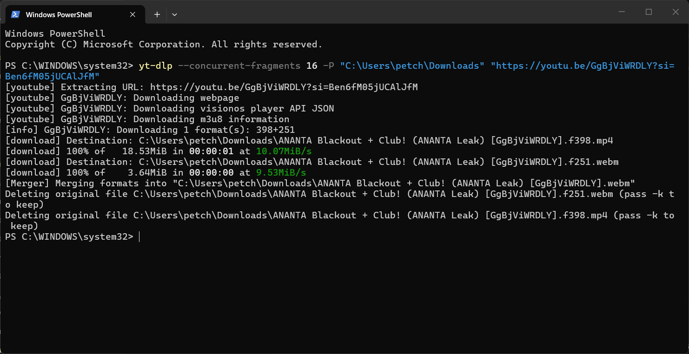

# 🎬 yt-dlp Video Download Guide (YouTube, Facebook, Bilibili, Streamable)

คู่มือ คำสั่งใช้งาน วิธีแก้ไขปัญหา และขั้นตอนการติดตั้ง **yt-dlp** ร่วมกับ **FFmpeg** สำหรับดาวน์โหลดวิดีโอความเร็วสูงจากแพลตฟอร์มชั้นนำ ได้อย่างสมบูรณ์แบบ

---

## 📥 ขั้นตอนการติดตั้ง (Installation)

เพื่อให้สามารถดาวน์โหลดและรวมไฟล์วิดีโอความละเอียดสูง (1080p, 4K) หรือแปลงเป็น MP3 ได้อย่างสมบูรณ์ ควรติดตั้งทั้ง **yt-dlp** และ **FFmpeg** ครับ

### 1. ติดตั้ง yt-dlp
เปิด **PowerShell** หรือ **Command Prompt** แล้วรันคำสั่ง:
```powershell
winget install yt-dlp

```

### 2. ติดตั้ง FFmpeg (จำเป็นสำหรับการผสานไฟล์วิดีโอและเสียง)

รันคำสั่งผ่าน PowerShell:

```powershell
winget install Gyan.FFmpeg

```

> 💡 **ตรวจสอบการติดตั้ง:** พิมพ์ `yt-dlp --version` และ `ffmpeg -version` เพื่อเช็กความพร้อม

---

## 🌐 แพลตฟอร์มที่รองรับและคำสั่งแนะนำ

| แพลตฟอร์ม | ตัวอย่างคำสั่ง / เทคนิคที่แนะนำ |
| --- | --- |
| **YouTube** | ใช้ `--concurrent-fragments` เร่งสปีด และระบุโฟลเดอร์ปลายทาง |
| **Facebook / Reels** | ใช้ระบุพารามิเตอร์ `-P` เพื่อเซฟลงโฟลเดอร์ปลายทางโดยตรง |
| **Bilibili (จีน)** | ใช้ `--concurrent-fragments 16` หรือ `100` เร่งสปีด และรองรับการดึง Cookies |
| **Streamable** | ดึงไฟล์ MP4 ความเร็วสูงโดยตรง |

---

## 🚀 ตัวอย่างคำสั่งใช้งานจริงและวิธีระบุโฟลเดอร์ (PowerShell / CMD)

เพื่อป้องกันปัญหา `Permission Denied` (เนื่องจากบันทึกในโฟลเดอร์ระบบ เช่น System32) แนะนำให้ใช้พารามิเตอร์ `-P` เพื่อระบุโฟลเดอร์ปลายทาง เช่น โฟลเดอร์ Downloads:

### 1. YouTube (พร้อมระบุโฟลเดอร์ Downloads)

```cmd
yt-dlp --concurrent-fragments 16 -P "C:\Users\petch\Downloads" "[https://youtu.be/GgBjViWRDLY](https://youtu.be/GgBjViWRDLY)"

```

### 2. Facebook Reels

```cmd
yt-dlp -P "C:\Users\petch\Downloads" "[https://www.facebook.com/reel/2193380978264902](https://www.facebook.com/reel/2193380978264902)"

```

### 3. Bilibili (จีน) (เร่งสปีดและดึงพรีเมียมคุกกี้ถ้าจำเป็น)

```cmd
yt-dlp --concurrent-fragments 16 -P "C:\Users\petch\Downloads" "[https://www.bilibili.com/video/BV1rfH666E9P](https://www.bilibili.com/video/BV1rfH666E9P)"

```

### 4. Streamable

```cmd
yt-dlp -P "C:\Users\petch\Downloads" "[https://streamable.com/kzejhv](https://streamable.com/kzejhv)"

```

---

## 🔑 เทคนิคแก้ไขปัญหา (Troubleshooting)

### 🍪 1. แก้ปัญหา `Could not copy Chrome cookie database`

* **สาเหตุ:** เกิดจาก **Google Chrome กำลังเปิดใช้งานอยู่** ทำให้ไฟล์ Cookies โดนล็อก


* **วิธีแก้:** ปิดหน้าต่าง Chrome ทั้งหมด (รวมถึงตรวจสอบใน Task Manager) แล้วลองรันคำสั่งใหม่อีกครั้ง


### ⛔ 2. แก้ปัญหา `[Errno 13] Permission denied`

* **สาเหตุ:** โปรแกรมพยายามบันทึกไฟล์ลงในโฟลเดอร์ระบบ (เช่น `C:\WINDOWS\system32`)
* **วิธีแก้:** เพิ่มพารามิเตอร์ `-P "C:\Users\petch\Downloads"` เพื่อระบุตำแหน่งบันทึกไฟล์ไปที่โฟลเดอร์ Downloads

### 🌍 3. แก้ปัญหา `This video may be deleted or geo-restricted`

* **สาเหตุ:** คลิปถูกลบ หรือจำกัดการเข้าถึงเฉพาะในประเทศจีน (Region Lock)


* **วิธีแก้:** ใช้ VPN หรือ Proxy ที่เชื่อมต่อไปยังประเทศจีนก่อนทำการดาวน์โหลด


---

## 🎯 ตัวอย่างผลลัพธ์การดาวน์โหลดสำเร็จ (Success Example)

**YouTube**


**Reels**
.png)

**Facebook**
.png)

**Bilibili (จีน)**
.png)

**Streamable**
.png)

---

## ⚙️ สรุปตัวเลือกพารามิเตอร์สำคัญ

* `-P` / `--paths` : กำหนดโฟลเดอร์ปลายทางสำหรับบันทึกไฟล์ (แก้ปัญหา Permission Denied)
* `--concurrent-fragments N` : กำหนดจำนวน Connection/Fragment สำหรับดาวน์โหลดพร้อมกัน (เช่น 16, 100)
* `--cookies-from-browser` : ดึงข้อมูลสิทธิ์ล็อกอินจากเบราว์เซอร์
* `-x` / `--extract-audio` : ดึงเฉพาะไฟล์เสียงออกจากวิดีโอ
* `-U` / `--update` : อัปเดตตัวโปรแกรม yt-dlp เป็นเวอร์ชันล่าสุด